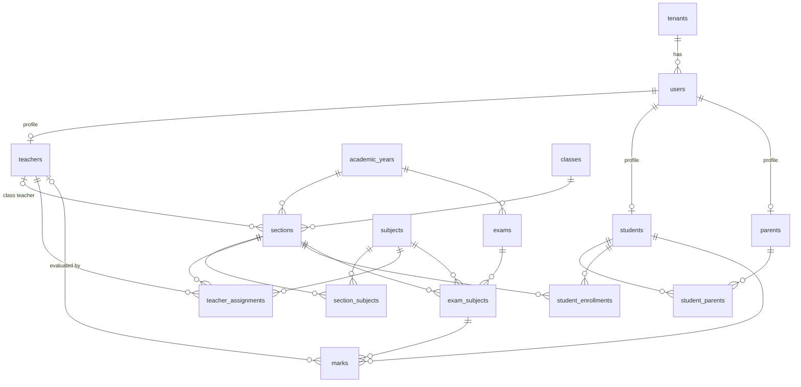

# Data Model

The backend uses two databases, each for the kind of data it handles best.

| | PostgreSQL | MongoDB |
|---|---|---|
| **Holds** | Core records of the school: people, academics, exams, marks (and later attendance, fees, timetable) | Logs and flexible documents: audit trail (and later notifications, files, import jobs) |
| **Why** | Foreign keys, unique and check constraints, multi-row transactions, joins for reports | Append-heavy writes, schema-free payloads, no joins needed |
| **Access** | Drizzle ORM (`src/database/postgres`) | Mongoose (`src/database/mongo`) |
| **Schema changes** | SQL migrations (`npm run db:generate`, then `npm run db:migrate`) | Schemas in code; `npm run mongo:sync-indexes` for indexes |

**Rule of thumb for new data:** if other records reference it, it must be unique, or it is reported on with joins, it goes in **PostgreSQL**. If it is written once and read back as a whole document (logs, messages, uploaded-file metadata, per-school custom fields), it goes in **MongoDB**.

---

## Conventions (PostgreSQL)

- **Primary keys:** `id uuid DEFAULT gen_random_uuid()`. The API exposes these as `id`.
- **Tenancy:** every table has `tenant_id → tenants.id`. Every query filters by the tenant from the JWT, so one school never sees another's rows.
- **Soft delete:** `is_active boolean`. Reads only return active rows. Where a soft-deleted row could block re-creating it, the unique index is **partial** (`WHERE is_active = true`).
- **Timestamps:** `created_at` and `updated_at` (`timestamptz`), maintained automatically.
- **Dates without time** (dob, start/end dates) use the `date` type and are returned as `"YYYY-MM-DD"`.
- **Naming:** tables and columns are `snake_case` in SQL and `camelCase` in the API (`class_order` ↔ `classOrder`).
- **Enums** are PostgreSQL enum types: `user_role`, `user_status`, `gender`, `employment_type`, `parent_relation`, `subject_type`, `admission_type`, `enrollment_status`, `exam_type`.

Source of truth: [`src/database/postgres/schema/`](../src/database/postgres/schema/). Generated SQL: [`migrations/`](../src/database/postgres/migrations/).

---

## PostgreSQL tables

### Tenancy — `tenancy.schema.js`

| Table | Purpose | Key constraints |
|---|---|---|
| `tenants` | One row per school | `code` unique |
| `serial_counters` | Per-school number sequences behind generated codes | PK (`tenant_id`, `scope`). Incremented atomically with `INSERT … ON CONFLICT`, and rolled back with the surrounding transaction (no gaps) |

### People — `people.schema.js`

| Table | Purpose | Key constraints |
|---|---|---|
| `users` | Login identity and personal details for every person (role: ADMIN, TEACHER, STUDENT, PARENT) | unique (`tenant_id`, `email`). Email stored lower-case. `password_hash` is never returned by the API |
| `teachers` | Teacher profile | `user_id` unique → `users`. Unique (`tenant_id`, `employee_code`) |
| `students` | Student profile | `user_id` unique → `users`. Unique (`tenant_id`, `admission_number`) and (`tenant_id`, `student_code`) |
| `parents` | Parent/guardian profile | `user_id` unique → `users`. Unique (`tenant_id`, `parent_code`). `annual_income numeric(12,2)` |
| `student_parents` | Which parents belong to which student, with relation and primary contact | → `students`, → `parents`. Partial unique (`student_id`, `parent_id`) on active rows |

### Academics — `academics.schema.js`

| Table | Purpose | Key constraints |
|---|---|---|
| `academic_years` | School years (2026-27) | unique (`tenant_id`, `year_name`). **Partial unique (`tenant_id`) where `is_current`**, so at most one current year per school. CHECK `end_date > start_date` |
| `classes` | Grade levels, shared across years | unique (`tenant_id`, `class_name`) and (`tenant_id`, `class_order`) |
| `sections` | A class's division in one year (Class 1-A, 2026-27) | → `academic_years`, → `classes`, → `teachers` (class teacher). Unique (`academic_year_id`, `class_id`, `section_name`). CHECK `capacity > 0` |
| `subjects` | Subjects offered | unique (`tenant_id`, `subject_code`) and (`tenant_id`, `subject_name`). Code stored upper-case |
| `section_subjects` | Subjects taught in a section | → `sections`, → `subjects`. Partial unique (`section_id`, `subject_id`) and (`section_id`, `display_code`) |
| `teacher_assignments` | Who teaches a subject in a section | → `teachers`, → `sections`, → `subjects`. Partial unique (`section_id`, `subject_id`): one teacher per subject per section |
| `student_enrollments` | A student's section and roll number for one year. Promotion adds the next year's row and marks the old one `LEFT` | → `students`, → `sections`. Unique (`academic_year_id`, `student_id`) and (`section_id`, `roll_number`) |

### Exams — `exams.schema.js`

| Table | Purpose | Key constraints |
|---|---|---|
| `exams` | An exam in a year (Mid Term, Final) | → `academic_years`. Unique (`academic_year_id`, `exam_name`). CHECK dates in order |
| `exam_subjects` | One paper: a subject a section sits in an exam, with max/pass marks | → `exams`, → `sections`, → `subjects`. Unique (`exam_id`, `section_id`, `subject_id`). CHECK `max_marks > 0` and `pass_marks` between 0 and `max_marks` |
| `marks` | A student's result for one paper | → `students`, → `exam_subjects`, → `teachers` (evaluator). Unique (`student_id`, `exam_subject_id`), which is also the upsert target. CHECK `marks_obtained >= 0` (≤ max is checked by the API). Marks use `numeric(6,2)` and are returned as numbers |

### Relationships

`tenant_id` on every table is omitted from the diagram for readability.

### API names vs table names

Some endpoints keep their original names:

| Endpoint | Table |
|---|---|
| `/academic/class-section-subject-map` | `section_subjects` |
| `/academic/teacher-section-subject-map` | `teacher_assignments` |
| `/academic/student-section-map` | `student_enrollments` |
| `/academic/exam-section-subject-map` | `exam_subjects` (marks reference it as `examSubjectId`) |

---

## MongoDB collections

### Now

| Collection | Model | Purpose | Indexes |
|---|---|---|---|
| `auditlogs` | [`auditLog.model.js`](../src/database/mongo/models/auditLog.model.js) | One document per successful write: who, what, which record, request path, status, and sanitized payload (passwords and tokens stripped, large bulk arrays summarized). Written after the response is sent; a failure never breaks the request | (`tenantId`, `entityType`, `entityId`, `createdAt`) for a record's history; (`tenantId`, `userId`, `createdAt`) for a user's activity |

IDs in Mongo documents (`tenantId`, `userId`, `entityId`) are the **PostgreSQL UUIDs** stored as strings. There are no cross-database foreign keys; PostgreSQL stays the source of truth.

### Planned (by roadmap phase)

| Collection | Phase | Why MongoDB |
|---|---|---|
| `notifications` / `messages` | 4 | High write volume, per-recipient read state, varied payloads (email, SMS, push) |
| `announcements` | 4 | Rich content, attachments, audience rules |
| `report_snapshots` | 5 | Frozen report cards and exports as generated, read whole |
| `files` (metadata) | 6 | Upload metadata (S3 key, type, size, tags). The files themselves live in object storage |
| `import_jobs` | 2–3 | Bulk import progress and per-row errors |
| `custom_fields` | later | Per-school extra fields on student or teacher profiles |

### Planned PostgreSQL tables (for comparison)

Attendance (`attendance_sessions`, `attendance_records`), timetable (`periods`, `timetable_slots`), grade scales, fees (`fee_categories`, `fee_structures`, `invoices`, `payments`, `receipts`), library, transport, hostel, payroll and inventory are relational: they reference students, sections and money, need constraints, and are reported on with joins.

---

## Changing the schema

1. Edit the table in `src/database/postgres/schema/*.schema.js`.
2. `npm run db:generate -- --name <short_description>` writes a new SQL file to `migrations/`. Review it.
3. `npm run db:migrate` applies it (also run on every deploy).
4. Update this document.
