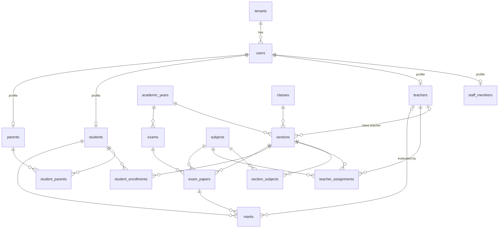

# Data Model

The backend uses two databases, each for the kind of data it handles best.

| | PostgreSQL | MongoDB |
|---|---|---|
| **Holds** | Core records of the school: people, academics, exams, marks (and later attendance, fees, timetable) | Logs and flexible documents: audit trail (and later notifications, files, import jobs) |
| **Why** | Foreign keys, unique and check constraints, multi-row transactions, joins for reports | Append-heavy writes, schema-free payloads, no joins needed |
| **Access** | Drizzle ORM through `createRepository` (`src/common/database`) | Mongoose |
| **Schema changes** | SQL migrations (`npm run db:generate`, then `npm run db:migrate`) | Schemas in code; `npm run mongo:sync-indexes` for indexes |

**Rule of thumb for new data:** if other records reference it, it must be unique, or it is reported on with joins, it goes in **PostgreSQL**. If it is written once and read back as a whole document (logs, messages, uploaded-file metadata, per-school custom fields), it goes in **MongoDB**.

---

## Where definitions live

- Each submodule owns its tables in `src/modules/<module>/<submodule>/models/*.schema.js`.
- Enums shared inside a module live in `src/modules/<module>/shared/`.
- Platform tables used by the framework (`tenants`, `serial_counters`) are in `src/common/database/platform.schema.js`.
- `src/database.schema.js` registers them all with the ORM.
- Generated SQL: [`migrations/`](../migrations/).

## Conventions (PostgreSQL)

- **Base columns** (`baseColumns()` in `common/database/columns.js`) on every module table: `id uuid DEFAULT gen_random_uuid()`, `tenant_id → tenants.id`, `is_active`, `created_at`, `updated_at`.
- **Tenancy:** every query is scoped to the tenant from the JWT by the base repository, so one school never sees another's rows.
- **Soft delete:** `is_active = false`. Reads only return active rows. Where a soft-deleted row could block re-creating it, the unique index is **partial** (`WHERE is_active = true`).
- **Dates without time** (dob, start/end dates) use `date` and are returned as `"YYYY-MM-DD"`. Marks use `numeric(6,2)` and are returned as numbers. Money uses `numeric(12,2)`.
- **Naming:** `snake_case` in SQL, `camelCase` in the API (`class_order` ↔ `classOrder`).
- **Enums** (PostgreSQL enum types; values defined once in each module's `shared/constants`):
  - `user_role`: ADMIN, PRINCIPAL, ACCOUNTANT, STAFF, TEACHER, STUDENT, PARENT
  - `user_status`, `gender`, `employment_type`, `parent_relation`
  - `subject_type`, `admission_type`, `enrollment_status`, `exam_type`

---

## PostgreSQL tables (18)

### Platform: `common/database/platform.schema.js`

| Table | Purpose | Key constraints |
|---|---|---|
| `tenants` | One row per school | `code` unique |
| `serial_counters` | Per-school number sequences behind generated codes | PK (`tenant_id`, `scope`). Incremented atomically with `INSERT … ON CONFLICT` and rolled back with the surrounding transaction (no gaps) |

### Users module

| Submodule | Table | Purpose | Key constraints |
|---|---|---|---|
| accounts | `users` | Login identity and personal details for every person | unique (`tenant_id`, `email`); email stored lower-case. `password_hash` is never returned |
| staff | `staff_members` | Profile of privileged users (ADMIN, PRINCIPAL, ACCOUNTANT, STAFF): employee code, designation, department | `user_id` unique → `users`. Unique (`tenant_id`, `employee_code`). Code `STF<yy>-000001` |
| teachers | `teachers` | Teacher profile | `user_id` unique → `users`. Unique (`tenant_id`, `employee_code`). Code `TCHR<yy>-000001` |
| parents | `parents` | Parent/guardian profile | `user_id` unique → `users`. Unique (`tenant_id`, `parent_code`) |
| students | `students` | Student profile | `user_id` unique → `users`. Unique (`tenant_id`, `admission_number`) and (`tenant_id`, `student_code`) |
| students | `student_parents` | Which parents belong to which student (relation, primary contact) | → `students`, → `parents`. Partial unique (`student_id`, `parent_id`) on active rows. One parent can be linked to several siblings |

### Academics module

| Submodule | Table | Purpose | Key constraints |
|---|---|---|---|
| academic-years | `academic_years` | School years (2026-27) | unique (`tenant_id`, `year_name`). **Partial unique (`tenant_id`) where `is_current`**, so at most one current year. CHECK `end_date > start_date` |
| classes | `classes` | Grade levels, shared across years | unique (`tenant_id`, `class_name`) and (`tenant_id`, `class_order`) |
| subjects | `subjects` | Subjects offered | unique (`tenant_id`, `subject_code`) and (`tenant_id`, `subject_name`) |
| sections | `sections` | A class's division in one year (Class 1-A, 2026-27) | → `academic_years`, `classes`, `teachers` (class teacher). Unique (`academic_year_id`, `class_id`, `section_name`). CHECK `capacity > 0` |
| section-subjects | `section_subjects` | Subjects taught in a section | Partial unique (`section_id`, `subject_id`) and (`section_id`, `display_code`) |
| teacher-assignments | `teacher_assignments` | Who teaches a subject in a section | Partial unique (`section_id`, `subject_id`): one teacher per subject per section |
| enrollments | `student_enrollments` | A student's section and roll number for one year. Promotion adds the next year's row and marks the old one `LEFT` | Unique (`academic_year_id`, `student_id`) and (`section_id`, `roll_number`) |
| exams | `exams` | An exam in a year (Mid Term, Final) | Unique (`academic_year_id`, `exam_name`). CHECK dates in order |
| exams | `exam_papers` | One paper: a subject a section sits in an exam, with max/pass marks | Unique (`exam_id`, `section_id`, `subject_id`). CHECK `max_marks > 0`, `pass_marks` between 0 and `max_marks` |
| marks | `marks` | A student's result in one paper | → `students`, `exam_papers`, `teachers` (evaluator). Unique (`student_id`, `exam_paper_id`), also the upsert target. CHECK `marks_obtained >= 0` (≤ max is checked by the API) |

### Relationships

`tenant_id` on every table is omitted from the diagram for readability.

---

## MongoDB collections

### Now

| Collection | Model | Purpose | Indexes |
|---|---|---|---|
| `auditlogs` | [`common/audit/auditLog.model.js`](../src/common/audit/auditLog.model.js) | One document per successful write: who (user, role), which permission was used (e.g. `users.students.admit`), which record, path, status, and the sanitized body (secrets removed, arrays over 50 items summarized). Written after the response is sent; a failure never breaks the request | (`tenantId`, `entityId`, `createdAt`) for a record's history; (`tenantId`, `userId`, `createdAt`) for a user's activity; (`tenantId`, `permission`, `createdAt`) for an action's history |

IDs in Mongo documents are the **PostgreSQL UUIDs** stored as strings. There are no cross-database foreign keys; PostgreSQL stays the source of truth.

### Planned (by roadmap phase)

| Collection | Phase | Why MongoDB |
|---|---|---|
| `import_jobs` | 3 | Bulk import progress and per-row errors |
| `notifications` / `messages` | 4 | High write volume, per-recipient read state, varied payloads (email, SMS, push) |
| `announcements` | 4 | Rich content, attachments, audience rules |
| `report_snapshots` | 5 | Frozen report cards and exports as generated, read whole |
| `files` (metadata) | 6 | Upload metadata (S3 key, type, size, tags). Files themselves live in object storage |
| `custom_fields` | later | Per-school extra fields on profiles |

Planned **PostgreSQL** tables, for comparison: attendance, timetable, grade scales, fees (categories, structures, invoices, payments, receipts), library, transport, hostel, payroll, inventory. These reference students, sections and money, need constraints, and are reported on with joins.

---

## Changing the schema

1. Edit (or add) a `models/*.schema.js` file in the owning submodule. Register new files in `src/database.schema.js`.
2. `npm run db:generate -- --name <short_description>` writes a SQL file to `migrations/`. Review it.
3. `npm run db:migrate` applies it (also run on every deploy).
4. Update this document.
