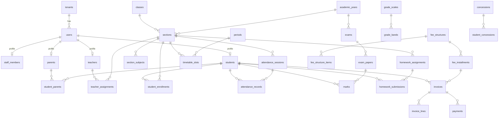

# Data Model

The backend uses two databases, each for the kind of data it handles best.

| | PostgreSQL | MongoDB |
|---|---|---|
| **Holds** | The school's records: people, academics, attendance, timetable, exams, marks, homework, fees, payments, and the operations modules | Logs and documents: audit trail, notifications, announcements, import jobs, file metadata, once-only claims |
| **Why** | Foreign keys, unique and check constraints, multi-row transactions, row locks, joins for reports | Append-heavy writes, flexible payloads, read back whole, no joins needed |
| **Access** | Drizzle ORM through `createRepository` (`src/common/database`) | Mongoose, through `createMongoRepository` where a module needs CRUD |
| **Schema changes** | SQL migrations (`npm run db:generate`, then `npm run db:migrate`) | Schemas in code; `npm run mongo:sync-indexes` for indexes |

**Rule of thumb for new data:**
- **PostgreSQL** if other records reference it, it must be unique or consistent with other rows, it involves money, or it is reported on with joins.
- **MongoDB** if it is written once and read back as a whole document (logs, messages, file metadata).

---

## Where definitions live

- Each submodule owns its tables in `src/modules/<module>/<submodule>/models/*.schema.js`. MongoDB models are in `models/*.model.js`.
- Enums used in several submodules of a module live in `src/modules/<module>/shared/constants`.
- Platform tables used by the framework (`tenants`, `serial_counters`) are in `src/common/database/platform.schema.js`.
- `src/database.schema.js` registers every table with the ORM.
- Generated SQL lives in [`migrations/`](../migrations/). It also holds hand-written triggers, such as the archived-year guard.

## Conventions (PostgreSQL)

- **Base columns** (`baseColumns()` in `common/database/columns.js`) are on every module table:
  - `id uuid DEFAULT gen_random_uuid()`
  - `tenant_id → tenants.id`
  - `is_active`, `created_at`, `updated_at`
- **Tenancy:** the base repository scopes every query to the tenant from the JWT, so one school never sees another's rows. Raw SQL (the reports read model) filters `tenant_id` explicitly. Row-level security as a second layer is designed in [OPERATIONS.md](OPERATIONS.md#design-note-postgresql-row-level-security).
- **Soft delete:** `is_active = false`, and reads only return active rows. Where a soft-deleted row could block re-creating it, the unique index is **partial** (`WHERE is_active = true`).
- **Types:**
  - **Dates without time** (dob, due dates, attendance dates) use `date`, returned as `"YYYY-MM-DD"`. "Today" is the school's time zone (`tenants.timezone`).
  - **Marks** use `numeric(6,2)`, returned as numbers.
  - **Money** is `numeric(12,2)`, returned as numbers in rupees. Arithmetic is done in integer paise (`common/money`).
- **Invariants in the database:** CHECK constraints (dates in order, amounts positive, pass ≤ max), generated columns (`invoices.balance`) and triggers (archived years are read-only).
- **Concurrency:** rows whose invariants span requests are locked with `SELECT … FOR UPDATE`. Examples: invoices when paying, academic years when archiving.
- **Generated codes** (`STU26-000001`, `INV26-000001`, `RCPT26-000001`) come from `serial_counters`. They are gapless, because the counter increment rolls back with the transaction.
- **Naming:** `snake_case` in SQL, `camelCase` in the API (`class_order` ↔ `classOrder`).

---

## PostgreSQL tables

### Platform: `common/database/platform.schema.js`

| Table | Purpose | Key constraints |
|---|---|---|
| `tenants` | One row per school: name, contact, time zone, currency, country, `logo_key` | `code` unique |
| `serial_counters` | Per-school number sequences behind generated codes | PK (`tenant_id`, `scope`), incremented with `INSERT … ON CONFLICT` |

### Users module

| Submodule | Table | Purpose | Key constraints |
|---|---|---|---|
| accounts | `users` | Login identity and personal details for every person, any role | Unique (`tenant_id`, `email`); email stored lower-case. `password_hash` is never returned |
| staff | `staff_members` | ADMIN, PRINCIPAL, ACCOUNTANT and STAFF profile: employee code, designation, department | `user_id` unique. Code `STF<yy>-000001` |
| teachers | `teachers` | Teacher profile | `user_id` unique. Code `TCHR<yy>-000001` |
| parents | `parents` | Parent/guardian profile | `user_id` unique. Code `PRT<yy>-000001` |
| students | `students` | Student profile | `user_id` unique. Unique admission number and student code |
| students | `student_parents` | Which parents belong to which student (relation, primary contact) | Partial unique (`student_id`, `parent_id`). One parent can have several children |

### Academics module

| Submodule | Table | Purpose | Key constraints |
|---|---|---|---|
| academic-years | `academic_years` | School years (2026-27): weekly off days, current flag, `archived_at` | Unique name. **At most one current year** (partial unique). CHECK end > start. CHECK not both current and archived. **Archived years are read-only** (trigger) |
| classes | `classes` | Grade levels, shared across years | Unique name and order |
| subjects | `subjects` | Subjects offered | Unique code and name |
| sections | `sections` | A class's division in one year (1-A, 2026-27), with class teacher and capacity | Unique (year, class, section name). CHECK capacity > 0 |
| section-subjects | `section_subjects` | Subjects taught in a section | Partial unique (section, subject) and (section, display code) |
| teacher-assignments | `teacher_assignments` | Who teaches a subject in a section. Drives teacher record-level scope | Partial unique (section, subject) |
| enrollments | `student_enrollments` | A student's section and roll number for one year. Promotion adds next year's row | Unique (year, student) and (section, roll number) |
| calendar | `calendar_events` | Holidays, events and exam days that affect working days | CHECK end ≥ start |
| attendance | `attendance_sessions` | One register: section × date × period (0 = daily) | Unique (section, date, period) |
| attendance | `attendance_records` | One student's mark in a register: PRESENT, ABSENT, LATE, HALF_DAY, EXCUSED | Unique (session, student). Indexed by student/date and section/date |
| timetable | `periods` | The bell schedule for a year | Partial unique (year, period number). CHECK end > start |
| timetable | `timetable_slots` | Section × weekday × period → subject, teacher, room | Partial uniques stop clashes: one slot per section, one per teacher, one per room, per weekday and period |
| grading | `grade_scales`, `grade_bands` | Percentage bands → grade and grade point | One default scale per school. Unique grade per scale. CHECK band ranges |
| exams | `exams` | An exam in a year, with grade scale and `results_published_at` | Unique (year, exam name). CHECK dates in order |
| exams | `exam_papers` | A subject a section sits in an exam: date, start/end time, room, max/pass marks | Unique (exam, section, subject). CHECK max > 0, 0 ≤ pass ≤ max |
| marks | `marks` | A student's result in one paper, with auto grade | Unique (student, paper). CHECK marks ≥ 0 (≤ max is checked by the API) |
| homework | `homework_assignments` | Homework for a section and subject: due date, max marks, late policy. Attachments are stored files owned by the homework | CHECK due ≥ assigned, max marks > 0 |
| homework | `homework_submissions` | A student's submission: text, status SUBMITTED / GRADED / RETURNED, late flag, marks, feedback | Partial unique (homework, student). CHECK marks ≥ 0. Attachments are stored files owned by the submission |

### Finance module

| Submodule | Table | Purpose | Key constraints |
|---|---|---|---|
| fee-heads | `fee_heads` | Fee categories (Tuition, Transport…) | Partial unique code and name |
| fee-structures | `fee_structures` | What a class pays in a year, plus the late-fee rule | Partial unique (year, class, name). CHECK late fee ≥ 0 |
| fee-structures | `fee_structure_items` | Amount per fee head | Unique (structure, head). CHECK amount > 0 |
| fee-structures | `fee_installments` | How the year's fee is split (share %, due date) | Unique (structure, name). CHECK 0 < share ≤ 100 |
| concessions | `concessions` | Reusable discounts (percent or fixed, optionally for one head) | Partial unique name. CHECK value > 0 and percent ≤ 100 |
| concessions | `student_concessions` | A concession granted to a student for a year | Partial unique (student, concession, year) |
| invoices | `invoices` | One bill per student per installment: total, paid, **generated `balance`**, status, late fee | Unique number. Partial unique (student, installment) unless cancelled. CHECK amounts consistent |
| invoices | `invoice_lines` | Bill lines per fee head, after concessions | |
| payments | `payments` | Cash or online payments; one receipt each; gateway ids | Unique receipt number. **Unique gateway order and gateway payment id**, which makes webhooks idempotent. CHECK amount > 0 |

### Operations modules

<!-- OPERATIONS_MODULES -->

### Relationships (core)

`tenant_id` on every table is omitted from the diagram for readability.

---

## MongoDB collections

| Collection | Model | Purpose | Indexes |
|---|---|---|---|
| `auditlogs` | `common/audit/auditLog.model.js` | One document per successful write: who, which permission (e.g. `users.students.admit`), which record, status, and the sanitized body (secrets removed, long arrays summarized). Written after the response; a failure never breaks the request | (tenant, entity, time); (tenant, user, time); (tenant, permission, time) |
| `notifications` | `communication/notifications` | One per recipient: in-app inbox (read state) plus delivery status per channel (EMAIL, SMS) | (tenant, user, time); (tenant, user, readAt) |
| `announcements` | `communication/announcements` | Circulars with audience rules (everyone, roles, classes, sections), draft → published | (tenant, status, time) |
| `importjobs` | `administration/imports` | CSV import progress and per-row errors | (tenant, time) |
| `storedfiles` | `files/documents` | Upload metadata: owner, category, type, size, storage key (never returned), uploader | (tenant, owner type, owner id, time) |
| `jobclaims` | `common/jobs/claims.js` | Once-only side effects (results published, absence alert sent today) | Unique `key`; TTL 90 days |

IDs in Mongo documents are the **PostgreSQL UUIDs** stored as strings. There are no cross-database foreign keys; PostgreSQL stays the source of truth. File bytes live in object storage (S3 or local disk), never in a database.

---

## Changing the schema

1. Edit or add a `models/*.schema.js` file in the owning submodule, and register new files in `src/database.schema.js`.
2. `npm run db:generate -- --name <short_description>` writes a SQL file to `migrations/`. Review it. CI fails if a model changed without a migration.
3. `npm run db:migrate` applies it. It also runs on every deploy, through the `migrate` one-off.
4. Keep releases backwards compatible for one version: expand → migrate → contract (see [OPERATIONS.md](OPERATIONS.md#migrations)).
5. Update this document.
