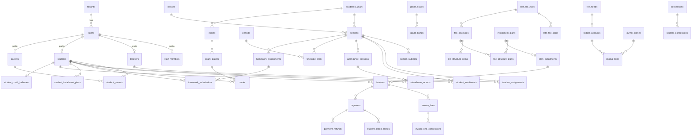

# Data Model

The backend uses two kinds of database, each for the kind of data it handles best. **Every school has its own PostgreSQL database and its own MongoDB database** (`school_<code>`). A small platform database lists the schools (see [OPERATIONS.md › A database per school](OPERATIONS.md#a-database-per-school)).

| | PostgreSQL | MongoDB |
|---|---|---|
| **Holds** | The school's records: people, academics, attendance, timetable, exams, marks, homework, fees, payments, library, transport, hostel, HR and payroll, inventory | Logs and documents: audit trail, notifications, announcements, import jobs, file metadata, once-only claims |
| **Why** | Foreign keys, unique and check constraints, multi-row transactions, row locks, joins for reports | Append-heavy writes, flexible payloads, read back whole, no joins needed |
| **Access** | Drizzle ORM through `createRepository` (`src/common/database`) | Mongoose, through `createMongoRepository` where a module needs CRUD |
| **Schema changes** | SQL migrations (`npm run db:generate`, then `npm run db:migrate`) | Schemas in code; `npm run mongo:sync-indexes` for indexes |

**Rule of thumb for new data:**
- **PostgreSQL** if other records reference it, it must be unique or consistent with other rows, it involves money, or it is reported on with joins.
- **MongoDB** if it is written once and read back as a whole document (logs, messages, file metadata).

---

## Where definitions live

- Each submodule owns its tables in `src/modules/<module>/<submodule>/models/*.schema.js`. MongoDB models are in `models/*.model.js`.
- Enums used in several submodules of a module live in `src/modules/<module>/shared/constants`.
- Framework tables in every school's database (`tenants`, `serial_counters`) are in `src/common/database/platform.schema.js`. The registry of schools is in `src/common/tenancy/registry.schema.js`.
- `src/database.schema.js` registers every table with the ORM.
- Generated SQL lives in [`migrations/`](../migrations/). It also holds hand-written triggers, such as the archived-year guard.

## Conventions (PostgreSQL)

- **Base columns** (`baseColumns()` in `common/database/columns.js`) are on every module table:
  - `id uuid DEFAULT gen_random_uuid()`
  - `tenant_id → tenants.id`
  - `is_active`, `created_at`, `updated_at`
- **Tenancy:** each school's rows are in that school's own database; a request can only reach the database of the school in its token. The `tenant_id` column and the repository's `tenant_id` filter stay as a second safety net (raw SQL filters it too).
- **Soft delete:** `is_active = false`, and reads only return active rows. Where a soft-deleted row could block re-creating it, the unique index is **partial** (`WHERE is_active = true`).
- **Types:**
  - **Dates without time** (dob, due dates, attendance dates) use `date`, returned as `"YYYY-MM-DD"`. "Today" is the school's time zone (`tenants.timezone`).
  - **Marks** use `numeric(6,2)`, returned as numbers.
  - **Money** is `numeric(12,2)`, returned as numbers in rupees. Arithmetic is done in integer paise (`common/money`).
- **Invariants in the database:** CHECK constraints (dates in order, amounts positive, pass ≤ max), generated columns (`invoices.balance`) and triggers (archived years are read-only).
- **Concurrency:** rows whose invariants span requests are locked with `SELECT … FOR UPDATE`. Examples: invoices when paying, academic years when archiving.
- **Generated codes** (`STU26-000001`, `INV26-000001`, `RCPT26-000001`) come from `serial_counters`. They are gapless, because the counter increment rolls back with the transaction.
- **Naming:** `snake_case` in SQL, `camelCase` in the API (`class_order` ↔ `classOrder`).

---

## PostgreSQL tables

### Platform registry: `common/tenancy/registry.schema.js`

In the platform database (`DATABASE_URL`) only, with its own migrations in `migrations-platform/`.

| Table | Purpose | Key constraints |
|---|---|---|
| `platform_tenants` | One row per school: code, name, ACTIVE/SUSPENDED, its PostgreSQL and MongoDB database names, and optional encrypted connection strings for a school on its own servers | `code` and `database_name` unique; `id` equals the school's `tenants.id` |

### School basics: `common/database/platform.schema.js`

In every school's database.

| Table | Purpose | Key constraints |
|---|---|---|
| `tenants` | One row per school: name, contact, time zone, currency, country, `logo_key` | `code` unique |
| `serial_counters` | Per-school number sequences behind generated codes | PK (`tenant_id`, `scope`), incremented with `INSERT … ON CONFLICT` |

### Users module

| Submodule | Table | Purpose | Key constraints |
|---|---|---|---|
| accounts | `users` | Login identity and personal details for every person, any role | Unique (`tenant_id`, `email`); email stored lower-case. `password_hash` is never returned |
| staff | `staff_members` | ADMIN, PRINCIPAL, ACCOUNTANT and STAFF profile: employee code, designation, department | `user_id` unique. Code `STF<yy>-000001` |
| teachers | `teachers` | Teacher profile | `user_id` unique. Code `TCHR<yy>-000001` |
| parents | `parents` | Parent/guardian profile | `user_id` unique. Code `PRT<yy>-000001` |
| students | `students` | Student profile | `user_id` unique. Unique admission number and student code |
| students | `student_parents` | Which parents belong to which student (relation, primary contact) | Partial unique (`student_id`, `parent_id`). One parent can have several children |

### Academics module

| Submodule | Table | Purpose | Key constraints |
|---|---|---|---|
| academic-years | `academic_years` | School years (2026-27): weekly off days, current flag, `current_until` (when it stopped being current: its teachers keep it one more month), `archived_at` | Unique name. **At most one current year** (partial unique). CHECK end > start. CHECK not both current and archived. **Archived years are read-only** (trigger) |
| classes | `classes` | Grade levels, shared across years | Unique name and order |
| subjects | `subjects` | Subjects offered | Unique code and name |
| sections | `sections` | A class's division in one year (1-A, 2026-27), with class teacher, optional deputy class teacher (`deputy_class_teacher_id`: daily and half-day registers and the section's scope, not report cards) and capacity | Unique (year, class, section name). CHECK capacity > 0. CHECK the deputy is not the class teacher |
| section-subjects | `section_subjects` | Subjects taught in a section | Partial unique (section, subject) and (section, display code) |
| teacher-assignments | `teacher_assignments` | Who teaches a subject in a section. With the class and deputy class teachers of `sections`, drives teacher record-level scope (current academic year only) | Partial unique (section, subject) |
| enrollments | `student_enrollments` | A student's section and roll number for one year. Promotion adds next year's row | Unique (year, student) and (section, roll number) |
| calendar | `calendar_events` | Holidays, events and exam days that affect working days | CHECK end ≥ start |
| attendance | `attendance_sessions` | One register: section × date × kind (DAY, FORENOON, AFTERNOON, PERIOD) × period (0 unless PERIOD). Periods keep the subject taught (the timetable's, or the one the teacher gave). `taken_by` is who took it last; `is_substitute` marks a period taken by a teacher neither timetabled for it nor assigned its subject | Unique (section, date, kind, period); CHECK period > 0 exactly when kind is PERIOD; CHECK only periods are substitute registers |
| attendance | `attendance_mode_rules` | How attendance is taken (DAILY, TWO_SESSIONS, PERIOD_WISE) from a date, for the school (`class_id` null) or one class (mode null = follow the school) | Partial unique (school, date) and (class, date); a school rule must have a mode. **A trigger refuses a rule starting before tomorrow** in the school's time zone (ZA422) |
| attendance | `attendance_records` | One student's mark in a register: PRESENT, ABSENT, LATE, HALF_DAY, EXCUSED | Unique (session, student). Indexed by student/date and section/date |
| timetable | `periods` | The bell schedule for a year | Partial unique (year, period number). CHECK end > start |
| timetable | `timetable_slots` | Section × weekday × period → subject, teacher, room | Partial uniques stop clashes: one slot per section, one per teacher, one per room, per weekday and period |
| grading | `grade_scales`, `grade_bands` | Percentage bands → grade, grade point and descriptor. Templates: CBSE 9-point, CBSE co-scholastic, IB 1–7, US 4.0, UGC 10-point | One default scale per school. Unique grade per scale. CHECK band ranges; bands tile 0–100 without gaps or overlaps (API) |
| exams | `exams` | An exam in a year, with grade scale and `results_published_at` | Unique (year, exam name). CHECK dates in order |
| exams | `exam_papers` | A subject a section sits in an exam: date, start/end time, room, max/pass marks. Optional `component` (THEORY, PRACTICAL…: one paper per component) and `grading_type` (MARKS, or GRADE for subjects graded without marks) | Partial unique (exam, section, subject) for whole papers and (…, component) for components. CHECK MARKS: max > 0, 0 ≤ pass ≤ max; GRADE: no max or pass |
| marks | `marks` | A student's result in one paper: marks or a grade alone, `grade_is_manual`, absence with `absence_reason` (ABSENT, MEDICAL, EXEMPT) | Unique (student, paper). CHECK marks ≥ 0 (≤ max is checked by the API), reason only when absent |
| result-policies | `result_policies` | How marks become results: grading mode (MARKS, GRADES, GPA, PASS_FAIL), scales, GPA scale, pass criteria, compartment, grace, best-of-N, absence treatment, ranking, rounding | Partial unique name; one default per school. CHECKs: GPA needs a GPA scale ≤ 10, percents 0–100, grace per subject ≤ total, decimals 0–4, pass/fail never ranks |
| result-policies | `result_policy_subjects` | Per subject: SCHOLASTIC / CO_SCHOLASTIC, credits, mandatory (best-of), own minimum % | Unique (policy, subject). CHECK credits > 0, co-scholastic never mandatory |
| result-policies | `result_policy_assignments` | Where a policy applies: an exam in one class, an exam, or a class | CHECK exam or class set. Partial unique per target |
| assessment-schemes | `assessment_schemes`, `assessment_scheme_exams` | A term or annual result combining exams by weight (Term 1 40% + Term 2 60%), optional own policy, `results_published_at` | Partial unique (year, name). Unique (scheme, exam). CHECK 0 < weight ≤ 100; weights sum to 100 (API). Archived-year guard |
| report-cards | `result_publications` | One version of an exam's or scheme's published results: who, when, superseded or withdrawn, report count, changed count | Unique (exam or scheme, version). **One current version per exam or scheme** (partial unique). Exam/scheme row locked while publishing. Archived-year guard |
| homework | `homework_assignments` | Homework for a section and subject: due date, max marks, late policy. Attachments are stored files owned by the homework | CHECK due ≥ assigned, max marks > 0 |
| homework | `homework_submissions` | A student's submission: text, status SUBMITTED / GRADED / RETURNED, late flag, marks, feedback | Partial unique (homework, student). CHECK marks ≥ 0. Attachments are stored files owned by the submission |

### Finance module

| Submodule | Table | Purpose | Key constraints |
|---|---|---|---|
| fee-heads | `fee_heads` | Fee categories (Tuition, Transport…) | Partial unique code and name |
| installment-plans | `installment_plans` | A year's ways of paying: Annual, Quarterly, Monthly… | Partial unique (year, name) |
| installment-plans | `plan_installments` | A plan's due dates and shares (the last absorbs rounding) | Unique (plan, sequence) and (plan, name). CHECK 0 < share ≤ 100. Shares add up to 100 (API) |
| installment-plans | `student_installment_plans` | The plan a student pays by in a year (null = each structure's default). Also the row locked to serialise billing, plan changes and concession changes | Unique (tenant, student, year) |
| late-fee-rules | `late_fee_rules` | Predefined late fees: grace days, optional maximum, school default | Partial unique name. **At most one default** (partial unique). CHECK grace 0–365, max > 0 |
| late-fee-rules | `late_fee_slabs` | Delay ranges with a FIXED or PER_DAY charge | Unique (rule, from day). CHECK from ≥ 1, to ≥ from, amount > 0. Contiguous from day 1 (API) |
| fee-structures | `fee_structures` | What a class pays in a year (annual amounts), whether it charges late fees, and its rule (none = school default) | Partial unique (year, class, name). CHECK no rule when it charges no late fee |
| fee-structures | `fee_structure_items` | Annual amount per fee head | Unique (structure, head). CHECK amount > 0 |
| fee-structures | `fee_structure_plans` | The plans a structure offers | Unique (structure, plan). **One default per structure** (partial unique) |
| concessions | `concessions` | Discount templates: percent, or fixed per year; category | Partial unique name. CHECK value > 0 and percent ≤ 100 |
| concessions | `concession_fee_heads` | The fee heads a concession is limited to (none = all) | Unique (concession, head) |
| concessions | `student_concessions` | A concession granted to a student for a year | Partial unique (student, concession, year) |
| invoices | `invoices` | One bill per student, structure and plan installment: gross, concessions, late fee (and waiver), total, paid, **generated `balance`**, status | Unique number. Partial unique (student, structure, installment) unless cancelled. **CHECK total = gross − concessions + late fee, and paid ≤ total** |
| invoices | `invoice_lines` | Bill lines per fee head: gross, concession, net | CHECK net = gross − concession, concession ≤ gross |
| invoices | `invoice_line_concessions` | Which concession took how much off a line (name copied for receipts) | CHECK amount > 0 |
| payments | `payments` | Cash or online payments; one receipt each; gateway ids; the part kept as credit; balance after | Unique receipt number. **Unique (tenant, gateway order) and (tenant, gateway payment id)**, which makes webhooks idempotent. CHECK amount > 0, 0 ≤ excess ≤ amount |
| payments | `payment_refunds` | Money paid back from a payment, or from a student's credit (no payment, no invoice). The amount is split into `from_credit`, `from_invoice` and `unallocated`. Also: method (ORIGINAL = back through the gateway); status (REQUESTED = waiting for an administrator, PENDING, PROCESSED, FAILED = reversed, REJECTED); source (STAFF, or GATEWAY for dashboard refunds); who requested, approved or rejected it, and why; `auto_approved` (within the school's approval limit). Numbered `RFND26-000001` on execution | Unique refund number and (provider, gateway refund id). CHECK the parts add up to the amount. **CHECK an executed staff refund has an approver**. A number exactly when executed. A credit refund is by hand, with nothing off an invoice. A rejection has a reason |
| settings | `finance_settings` | The school's finance settings: `refund_approval_limit` | Partial unique (tenant); CHECK limit ≥ 0 |
| settlements | `gateway_settlements` | Payment gateway payouts into the bank: amount that arrived, fees, tax, UTR, date, its journal entry | Unique (tenant, provider, settlement id): imported once |
| credits | `student_credit_balances` | A student's unused credit (overpayments), across years | Unique (tenant, student). **CHECK balance ≥ 0**; spent with a conditional update |
| credits | `student_credit_entries` | Credit history: OVERPAYMENT, APPLIED (to an invoice), REFUNDED (by a refund), REFUND_REVERSED | CHECK amount > 0; overpayments name their payment, applications their invoice |
| ledger | `ledger_accounts` | The school's chart of accounts: system accounts created on first use with stable codes (1000 Cash, 1010 Bank, 1020 Gateway clearing, 1100 Receivables, 1190 Refund suspense, 2100 Student credit, 3000 Opening balances, 4101… fee income per fee head, 4800 Late fees, 4900 Concessions as contra-income, 5800 Payment gateway charges) and the school's own | Partial unique (tenant, code), (tenant, system key) and (tenant, fee head). CHECK code format; fee-head accounts are FEE_INCOME income accounts |
| ledger | `journal_entries` | One balanced posting: `JE-000001`, date, narration, source (type, id, event), total, the entry it reverses | **Unique (tenant, source type, source id, event)**: a source event posts once. Unique reversal. **Triggers: no UPDATE/DELETE/TRUNCATE; deferred check at commit that debits = credits = total, ≥ 2 lines, one school** |
| ledger | `journal_lines` | A debit or a credit to an account, with the student for receivables and credit | CHECK exactly one side, positive. Same immutability and balance triggers |
| payment-settings | `payment_gateway_accounts` | The school's own Razorpay key id, **key secret and webhook secret encrypted at rest** | Partial unique tenant. Secrets never returned |

### Operations modules

Hostel, library, transport, HR and inventory have no foreign keys into each other. They reference users, students and academic years.

**Library**

| Submodule | Table | Purpose | Key constraints |
|---|---|---|---|
| policy | `library_policies` | One per school: fine block threshold, overdue block, closed days in fines, lost-copy fee and minimum, lost-and-found window, hold pickup days, reminders | Unique `tenant_id`. Created with the default rules on first read (`ON CONFLICT DO NOTHING`). CHECKs on amounts and days |
| circulation-rules | `library_circulation_rules` | Loan days, loan limit, renewals, fine per day, grace days, maximum fine per borrower role (students optionally by class) and item type | Unique scope (role, class, item type, empty ones included) among active rows. CHECK class only for students, no `REFERENCE` rule |
| books | `library_books` | Catalogue: title, `authors text[]`, ISBN (normalised, checksum-validated), item type, category, optional subject, staff-only notes | Partial unique ISBN when present. CHECK published year |
| copies | `library_copies` | Physical copies with accession number `ACC-000001`, barcode, status (incl. `ON_HOLD`, `MISSING`), item type override, price, source | Unique accession number (never reused). Partial unique barcode |
| loans | `library_loans` | Issue → return/lost (→ found); borrower role and item type at issue; the rule's terms copied at issue; late fine, lost, damage charges; paid, waived, credited | **One open loan per copy** (partial unique, plus row locks). Generated `fine_outstanding`. CHECKs: due ≥ issue, status ↔ return date, lost/found dates, paid − credited + waived ≤ charges |
| loans | `library_fine_payments` | Fine payments with receipt `LIBR-000001` (cash, UPI, card, library credit) | Unique receipt. CHECK amount > 0 |
| loans | `library_fine_waivers` | Partial or full waivers with reason and who waived | CHECK amount > 0 |
| loans | `library_credit_entries` | Library credit ledger per borrower (+ reversed charges, − fines paid from credit) | CHECK amount ≠ 0; balance checked under the borrower lock |
| holds | `library_holds` | Reservations: WAITING (queued by `requested_at`) → READY (copy kept until `pickup_by`) → FULFILLED / EXPIRED / CANCELLED | Partial unique open hold per borrower and title; one READY hold per copy. CHECK state ↔ copy and dates |
| stock-checks | `library_stock_checks`, `library_stock_check_scans` | Stock-takes and their scans (FOUND, UNEXPECTED, UNKNOWN) | One OPEN check per school (partial unique). A copy is scanned once per check (partial unique) |

Lock order in the library: borrower (advisory lock), then loan, then book, then its copies and holds. Every change to a title's copies or holds takes the book row lock first, so hold allocation is serial per title.

**Transport**

| Submodule | Table | Purpose | Key constraints |
|---|---|---|---|
| vehicles | `transport_vehicles` | Bus/van: normalised registration, capacity, driver and attendant, insurance, fitness and permit expiry dates, status | Partial unique registration. CHECK capacity > 0 |
| routes | `transport_routes` | Route with code, vehicle | Partial unique name and code. **A vehicle serves at most one active route** (partial unique) |
| routes | `transport_route_stops` | Ordered stops: pickup and drop times, monthly fee | Partial unique (route, sequence) and (route, name) |
| assignments | `transport_assignments` | A student's seat on a route and stop for a year, with direction; changes link to the row they replaced | **One active assignment per student per year** (partial unique). Capacity checked under a route row lock |

**Hostel**

| Submodule | Table | Purpose | Key constraints |
|---|---|---|---|
| library closures | `library_closures` | Days closed outside the school calendar, entered by hand (from, to, reason) | CHECK to ≥ from |
| hostels | `hostels` | Hostel with resident gender (BOYS/GIRLS/COED) and warden | Partial unique name and code |
| rooms | `hostel_rooms` | Rooms with capacity (beds), type, monthly fee, status | Partial unique (hostel, room number). CHECK 1 ≤ capacity ≤ 50 |
| allocations | `hostel_allocations` | A student's bed for a date range `[from_date, to_date]` (open-ended when `to_date` is null), not tied to an academic year: pre-bookings, changeovers, transfers and roll-overs link to the allocation they continue | **No two ACTIVE allocations of one bed, and none of one student, share a day**: GiST exclusion constraints on `daterange(from_date, to_date, '[]')` (btree_gist), plus a room row lock. CHECK to_date ≥ from_date |
| resources | `hostel_resources` | Lockers, cupboards, study tables (in a room or hostel-wide), mess and laundry plans (hostel-wide), custom types; capacity and monthly fee (stored, not invoiced) | Partial unique (hostel, name). CHECK 1 ≤ capacity ≤ 10000, plans have no room |
| resource-assignments | `hostel_resource_assignments` | A student's hold on a resource for a date range, tied to a bed allocation (ends with it) or standalone | Capacity per day checked under a resource row lock. Exclusion constraints: one hold of a resource per student per day, one mess (and one laundry) plan per student per day |

**HR**

| Submodule | Table | Purpose | Key constraints |
|---|---|---|---|
| staff-attendance | `staff_attendance` | Daily mark per employee, check-in/out, link to the leave that wrote it | Unique (tenant, user, date), also the upsert target |
| leaves | `leave_types` | Leave types with yearly quota, paid/unpaid, approval needed | Partial unique code and name. CHECK quota 0–366 |
| leaves | `leave_requests` | Requests with days (fixed at request time), half day, decision and cancellation trail | CHECK dates in order, days > 0, half day = one date and 0.5 |
| payroll | `salary_components` | Earnings and deductions: fixed or percent of basic | Partial unique code. CHECK percent ≤ 100 |
| payroll | `employee_salaries`, `employee_salary_lines` | Salary revisions effective from the 1st of a month, with component values. **Bank account and PAN are encrypted at rest** (AES-256-GCM) | Partial unique (user, effective from) |
| payroll | `payroll_runs` | One run per month: DRAFT → FINALIZED | Unique (tenant, month) |
| payroll | `payslips` | Snapshot per employee: earnings and deductions (jsonb), loss of pay, net pay, masked bank details. Numbered `PSL-202609-0001` at finalization | Unique (run, user) and payslip number. CHECK amounts ≥ 0 |

**Inventory**

| Submodule | Table | Purpose | Key constraints |
|---|---|---|---|
| categories | `inventory_categories` | Item categories | Partial unique `lower(name)` |
| vendors | `inventory_vendors` | Suppliers, optional GSTIN/tax id | Partial unique tax id |
| items | `inventory_items` | SKU, unit, reorder level, stock on hand, weighted average cost, discontinued flag | Partial unique SKU. CHECK stock, reorder level and cost ≥ 0 |
| stock | `stock_movements` | **Append-only ledger** (RECEIPT, ISSUE, RETURN, ADJUSTMENT) with balance and average cost after each movement, numbered `STK-000001` | CHECK direction per type, balance ≥ 0. **A trigger rejects UPDATE and DELETE.** Movements lock the item row |

**Access (administration/access)**: who may act in the add-on modules beyond their role

| Submodule | Table | Purpose | Key constraints |
|---|---|---|---|
| access | `operator_roles` | A school-defined set of permission keys (`text[]`) from ONE add-on module (library, transport, hostel, hr, inventory) | Partial unique (tenant, module, `lower(name)`). CHECK 1–100 permissions, **every key starts with the role's module**. The service also checks each key is in the catalogue and not owner-only or self-service |
| access | `access_assignments` | OPERATOR (holds an operator role) or OWNER (acts as the module's administrator) for a user, with optional `valid_from`/`valid_to` (inclusive). Revoked rows stay as history, with `revoke_reason`: `REVOKED` (by hand) or `HANDOVER` (ended by a handover, which created the matching row for the person taking over) | CHECK operator role ↔ kind, dates in order. **No two not-revoked assignments of one role to one user share a day**: GiST exclusion constraint (btree_gist), plus the role's row lock. Ownerships: advisory lock per (module, user) |

### Relationships (core)

`tenant_id` on every table is omitted from the diagram for readability.

---

## MongoDB collections

| Collection | Model | Purpose | Indexes |
|---|---|---|---|
| `auditlogs` | `common/audit/auditLog.model.js` | One document per successful write: who (`userId`, `role`, and `actor: { name, role }` as they were at the time), which permission (e.g. `users.students.admit`) with its `module` (`users`; from the path when there is no permission) and `action` (the catalogue label), the `summary` (the response's message), which record (`entityId`), method, path, status, and the sanitized body (secrets removed, long arrays summarized). Sign-in events are documents of module `auth`. Written after the response; a failure never breaks the request. Read-only: the central log and each module's activity tab | (tenant, entity, time); (tenant, user, time); (tenant, permission, time); (tenant, module, time) |
| `notifications` | `communication/notifications` | One per recipient: in-app inbox (read state) plus delivery status per channel (EMAIL, SMS) | (tenant, user, time); (tenant, user, readAt) |
| `announcements` | `communication/announcements` | Circulars with audience rules (everyone, roles, classes, sections), draft → published | (tenant, status, time) |
| `importjobs` | `administration/imports` | CSV import progress and per-row errors | (tenant, time) |
| `storedfiles` | `files/documents` | Upload metadata: owner, category, type, size, storage key (never returned), uploader | (tenant, owner type, owner id, time) |
| `jobclaims` | `common/jobs/claims.js` | Once-only side effects (results published, absence alert sent today, a teacher reminded of the day's missing registers) | Unique `key`; TTL 90 days |
| `report_snapshots` | `academics/report-cards` | A student's report card exactly as published, one per publication version: student, policy (with its settings), the report body (subjects, grades, GPA/CGPA, grace, result, ranks). **Write-once** (never updated or deleted; visibility lives in `result_publications`) and HMAC-**sealed**: the publication row lists every seal (`snapshot_seals`), so edits, forgeries and deletions are detected on read. The portal and its PDFs read these, never live marks | Unique (tenant, publication, student); (tenant, kind, source, version); (tenant, student, year, publishedAt) |

IDs in Mongo documents are the **PostgreSQL UUIDs** stored as strings. There are no cross-database foreign keys; PostgreSQL stays the source of truth. File bytes live in object storage (S3 or local disk), never in a database.

---

## Changing the schema

1. Edit or add a `models/*.schema.js` file in the owning submodule, and register new files in `src/database.schema.js`.
2. `npm run db:generate -- --name <short_description>` writes a SQL file to `migrations/`. Review it. CI fails if a model changed without a migration.
3. `npm run db:migrate` applies it. It also runs on every deploy, through the `migrate` one-off.
4. Keep releases backwards compatible for one version: expand → migrate → contract (see [OPERATIONS.md](OPERATIONS.md#migrations)).
5. Update this document.
